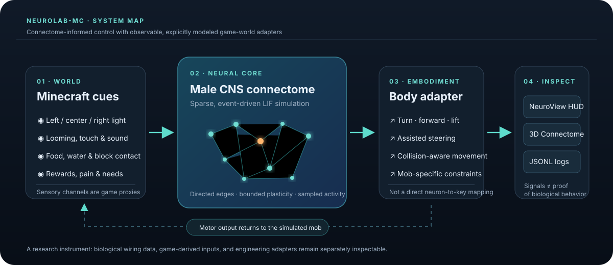

# NeuroLab-MC

[](https://github.com/Echrem/neurolab-mc/actions/workflows/build.yml)
[](https://www.minecraft.net/)
[](https://files.minecraftforge.net/)
[](LICENSE)

NeuroLab-MC is an experimental Forge mod that lets a connectome-backed neural simulation influence Minecraft mobs. It includes a custom fly mob for repeatable experiments, an adapter for attaching the same controller to other mobs, and a live client dashboard for watching the controller's output.

The point is to make an interesting, inspectable game experiment—not to claim that a fly's consciousness has been copied into Minecraft. The bundled graph is biological data; the stimulus encoding, neural parameters, and mapping from neural activity to game movement are still exploratory.

## Project status

The current release is **0.5.21** for Minecraft 1.21.1 / Forge 52.1.16. Download the installable JAR from [NeuroLab-MC Releases](https://github.com/Echrem/neurolab-mc/releases/latest), or build this source with `./gradlew build`. The mod keeps the `neurolab` registry namespace so existing worlds and saved entities remain compatible.
[Changes](CHANGELOG.md) · [Experiment protocol and reports](docs/EXPERIMENTS.md) · [Research references and open questions](docs/RESEARCH.md) · [Validation record](docs/VALIDATION.md) · [Data provenance](DATA_PROVENANCE.md)

## System overview



Neuro Fly world-response settings are server-side Forge common configuration in `config/neurolab-common.toml` (also available from the Forge Mods configuration screen): balanced/light/shade phototaxis, steering strength, cruise throttle, flower and host search radii, animal/villager perching, perch duration, and rain-shelter scan/response. The Ctrl+N dashboard SETTINGS button controls local panels and plots; it points to the separate server behavior settings. A nearby tracked mob renders a compact head-level connectome hologram: dim structural points and links are sampled from the bundled Male CNS soma coordinates and directed edges, while highlighted points come from that mob's sampled firing-neuron IDs. It is a sparse activity overlay—not a complete connectome rendering or a synaptic-current measurement.

Neuro Fly treats Minecraft brightness as a left/right visual gradient, slows continuously on approach, avoids exposed rain, and may periodically perch on passive livestock or villagers when conditions are calm. Flower attraction in assisted mode requires a positive flower encounter first. It measures cruising height from the floor below it, checks roof clearance, and follows a curved path into a ground landing. Close static passive mobs do not create a threat response; fast-closing bodies and non-zombie hostile mobs can. Zombie contact is not assigned a built-in chase or flee response: it supplies a small contact reward to the existing bounded plasticity rule, which adjusts recently active connectome edges. Zombies do not receive flower rewards or flower-seeking targets. Every attached mob has non-lethal hunger and thirst proxies; flowers and water can restore them, and low levels add neural sensory input without reducing health or killing the mob. Fire and lava remain noxious cues, and the individual's learned edge changes persist with its saved mob data. These are experimental learning/embodiment proxies, not evidence that this connectome learns Minecraft tasks biologically.

At a Neuro Monitor, click **SAVE / NAME BRAIN** to save the attached subject's learned edge changes under a name, then select and apply that imprint to another attached subject. Each monitor stores up to 16 named copies. This transfers only bounded, reward-modulated edge adjustments—not neuron activity, game-world cue memories, the full brain state, or a modified copy of the bundled Male CNS connectome. In the PC's **CONNECTOME** view, select a neuron to inspect its changed outgoing synapses; **G** switches to the subject's strongest changes across the graph and the mouse wheel scrolls the edge list. Green/red projected edges distinguish simulated positive/negative adjustments. Rows separate anatomical contact count and transmitter sign from fractional weight change. An empty list means no eligible pre/post spike pair has been reinforced in that view yet.

The assisted Minecraft adapter retains bounded cue associations for flower, tree, water, fire, zombie, villager, player, and encountered block types, plus a short-lived memory of blocked route cells. Outcomes accumulate gradually rather than switching at a fixed hit count: repeated damaging hits from one player UUID build an individual threat cue, while applied environmental damage pairs the contacted hazard block with pain. Once sufficiently aversive, the remembered player or block biases assisted steering away; other players do not inherit that identity cue. If health is observed to rise while the subject is grounded on a non-hazard block, that block receives a small positive association. This is only a temporal association and can be confounded by natural regeneration or other healing sources; it does not prove that a block caused healing. These per-mob memories persist separately from connectome weights and are inspectable on the PC. Immediate looming and pain reflexes remain distinct from the learned cue. These Minecraft behavior proxies are not evidence that the Male CNS connectome biologically learned player identity, block identity, or healing. Attached bees do not retain vanilla flower-seeking goals; flower attraction starts only after a positive flower encounter. An attached zombie's vanilla chase goals are disabled and it can begin pursuing a villager only after rewarded accidental contact. An attached villager's vanilla flee goals are disabled and zombie contact or attack can establish an aversive cue. The Neuro Monitor's **BEHAVIOR MAP** separates automatic reflexes, assisted body guidance, and learned responses. These are category labels supplied by Minecraft and a local route heuristic, **not visual object recognition, global path planning, or a reconstructed fly learning circuit**. Saved brain imprints copy only synaptic offsets; each mob's game-world cue history remains its own.

This is an early research prototype targeting Minecraft 1.21.1 and Forge. The Forge port is under active validation; until a client and dedicated-server play test passes, treat behavior and performance as experimental and use a backed-up test world.

## What is included

- A custom one-block **Neuro Fly** entity with a centered segmented body, compound eyes, six legs, animated wings, simple autonomous movement, and a Creative-mode spawn egg.
- A connectome reader for the bundled FLYB v1 graph and a sparse, event-driven leaky integrate-and-fire (LIF) simulator.
- Commands to attach the simulator to the Neuro Fly or another mob, inspect load status, and detach it.
- Timed sensory test pulses for controlled input/output checks.
- Visual, tactile, and olfactory probes for delivering bounded input pulses directly to an attached mob.
- A client-side engineering dashboard with a compact overview and a dedicated details page for each mob. Its configurable plots cover neural activity, outgoing edge visits, sensory inputs, decoded commands, body commands, and feedback proxies.
- A sampled 3D Male CNS connectome preview on the main dashboard and a full-screen rotatable anatomical view with visible directed synapse links; orange marks sampled firing IDs, not measured synaptic currents.
- A compact experiment chair with padded seat, overhead neural-interface arch, and a saved subject dock.
- A Neuro Viewer item and V shortcut that move the camera into an attached mob's view. While viewing that mob, press **I** to show or hide an in-world neural HUD with live activity, sensory and motor channels, learning state, reward/pain, and non-lethal hunger/thirst gauges; it never opens a separate screen or follows a nearby unrelated mob.
- A 3D Neuro Monitor block with a right-click lab console: bind a nearby subject, inspect live neuron activity by default, switch to vision or sensory/motor traces, cycle six electrodes, deliver pulses, change control mode, end a trial, detach safely, or terminate the selected tracked subject using the two-step-confirmed PC action. Its current subject and electrode survive world saves.
- A Neural Brain Attacher: right-click a living mob to attach the bundled connectome directly. Existing registry IDs are retained so worlds and saved items remain compatible.
- A scrollable in-game Q&A guide, available with **H** or from the analysis popup, in English and Turkish.
- Asynchronous JSONL telemetry written to the current world's `neurolab/events.jsonl` file.
- Offline HTML/SVG plots and CSV summaries grouped by session, mob, control mode, and trial.

The implementation is intentionally small enough to inspect. There is no separate launcher or account service, and the mod does not require Fabric API.

## Requirements

- Minecraft **1.21.1**
- Minecraft Forge **52.1.16** for Minecraft 1.21.1
- Java **21**

Install the mod JAR on the server and on every client that needs the custom entity renderer and analysis screen. For a local single-player experiment, the client installation is enough.

## Install a published release

1. Install [Minecraft Forge for 1.21.1](https://files.minecraftforge.net/net/minecraftforge/forge/index_1.21.1.html) and use Java 21 to run the game.
2. Download the `neurolab-mc-1.21.1-<version>.jar` asset from [GitHub Releases](https://github.com/Echrem/neurolab-mc/releases/latest). Choose the regular mod JAR, not the `-sources.jar` or GitHub's automatically generated **Source code** archives.
3. Put the mod JAR in the Forge profile's `mods` folder. The usual folders are `%appdata%\.minecraft\mods` on Windows, `~/Library/Application Support/minecraft/mods` on macOS, and `~/.minecraft/mods` on Linux. For a third-party launcher, use that launcher's instance-specific `mods` folder.
4. Select the Forge 1.21.1 profile and launch the game. Back up your test world before trying the prototype.

For a dedicated server, install the mod on the server and on each client joining it. Published releases carry the matching tested JAR; see [Contributing](CONTRIBUTING.md) for the versioning workflow.

## Quick start

1. Build the mod using the instructions below, or download the latest release JAR.
2. Put the JAR in the Forge installation's `mods` folder. No Fabric API is required.
3. Start a test world and spawn the fly using its Creative-mode spawn egg or this command:

   ```mcfunction
   /summon neurolab:neuro_fly
   ```

4. Neuro Fly entities automatically attach after they spawn and the bundled dataset finishes loading. Check the status:

   ```mcfunction
   /neurolab status
   ```

5. To attach another mob, target its actual entity type. For a sheep or villager, for example:

   ```mcfunction
   /neurolab attach @e[type=minecraft:sheep,limit=1,sort=nearest]
   /neurolab attach @e[type=minecraft:villager,limit=1,sort=nearest]
   ```

6. Open the dashboard with **Ctrl+N** and use **SETTINGS** to choose side panels and plots. The `N` key can be changed in Minecraft's Controls screen; Ctrl is the required modifier.
7. The top-right Neuro View HUD appears when a brain-attached mob is tracked nearby. Aim at one and press **V** to pin the HUD to its camera; press **V** again to return. Press **I** to show or hide the HUD.
8. Hold the **Neural Brain Attacher** and right-click any living mob to attach the connectome. The default assisted mode retains vanilla navigation; while you view a mob, extra neural movement impulses are disabled.
9. Place the **Neuro Experiment Chair** near a mob and right-click once to attach/select it as the experiment subject. The chair only docks the subject; use the Neuro Monitor or stimulus probes for measurements and test input. Sneak-right-click clears the dock and ends its trial.
10. For direct sensory tests, find the **Visual**, **Tactile**, **Olfactory**, **Acoustic**, **Gustatory**, and **Looming Stimulus Probes** in Creative Tools & Utilities. Right-click a brain-attached mob to send a 0.75 pulse for 40 game ticks; sneak-right-click uses 0.25. These are explicit sensory-channel proxy inputs, not calibrated biological stimuli and not direct movement commands. Acoustic input maps to the model's sound/mechanosensory cue, not a reconstructed fly ear.
11. Use the **Trial Recorder** on an attached mob while telemetry is running to mark a one-minute `field-<gameTick>` interval; sneak-right-click ends it early. Both boundaries are written to the session JSONL file. Use `/neurolab trial <mob> <label> <ticks>` when you need a custom label or duration.
12. Place the **Neuro Monitor** and right-click it. **LINK SUBJECT** first reuses a subject already bound to a nearby experiment chair; otherwise it attaches a mob within 6 blocks and starts a named trial. **ELECTRODE** cycles six sensory inputs; **PULSE** sends a bounded stimulus. MODE cycles assisted, neural, and observe; END TRIAL records the run; DETACH restores the subject's prior AI. The console does not pause the world.
13. Press **H** for the in-game question-and-answer guide covering movement, signals, learning, and controls. Its binding can be changed in Minecraft Controls.
14. When finished, detach a selected mob to restore its previous AI state:

   ```mcfunction
   /neurolab detach @e[type=neurolab:neuro_fly,limit=1,sort=nearest]
   ```

Useful checks:

```mcfunction
/neurolab status
/summon neurolab:neuro_fly
/neurolab attach @e[type=minecraft:sheep,limit=1,sort=nearest]
/neurolab stimulate @e[type=neurolab:neuro_fly,limit=1,sort=nearest] looming 1 40
/neurolab detach @e[type=neurolab:neuro_fly,limit=1,sort=nearest]
```

Neuro Fly spawn eggs and `/summon neurolab:neuro_fly` attach automatically. Other mobs can be attached with `/neurolab attach <entity selector>`; use the exact type in the selector, such as `minecraft:sheep`, `minecraft:villager`, or `minecraft:spider`. The mod has no fixed attached-mob limit. Brain tasks share a CPU-sized worker pool, so adding many mobs can reduce the real-time factor and increase server load. In `assisted` mode ordinary mobs keep vanilla pathfinding and receive bounded neural steering impulses; the custom Neuro Fly uses its dedicated flight controller. `neural` mode is the explicit full-control condition. Detaching restores the mob's original AI state.

For controlled input/output checks, use `/neurolab stimulate <mob> <sense> <strength> [ticks]`. Strength is 0–1, duration defaults to 40 ticks, and the maximum duration is 1200 ticks. Supported senses are `eye`, `left_eye`, `right_eye`, `looming`, `touch`, `odor`, and `taste`. Stimuli enter sensory channels only; this command does not set motor output directly. NeuroLab commands require operator permission on a server.

## Controlled comparisons

Switch an attached mob between three explicit conditions without restarting its neural worker:

| Mode | Neural simulation | Minecraft movement |
| --- | --- | --- |
| `assisted` (default) | Running | Neural output, with the labeled reflex/exploration fallback when silent |
| `neural` | Running | Neural output only; silent motor channels produce no forward/turn/lift commands |
| `observe` | Running | Original AI state restored; NeuroLab records output but does not apply body commands |

```mcfunction
/neurolab mode @e[type=neurolab:neuro_fly,limit=1,sort=nearest] neural
/neurolab inspect @e[type=neurolab:neuro_fly,limit=1,sort=nearest]
/neurolab trial @e[type=neurolab:neuro_fly,limit=1,sort=nearest] wall_baseline 1200
/neurolab endtrial @e[type=neurolab:neuro_fly,limit=1,sort=nearest]
/neurolab stimulate @e[type=neurolab:neuro_fly,limit=1,sort=nearest] left_eye 0.8 100
/neurolab unstimulate @e[type=neurolab:neuro_fly,limit=1,sort=nearest]
/neurolab mode @e[type=neurolab:neuro_fly,limit=1,sort=nearest] observe
```

Mode and sense arguments support tab completion. `/neurolab trial <mob> <label> <ticks>` marks a named interval of 1–12000 server ticks (up to ten minutes); labels use letters, numbers, dots, underscores, and hyphens. `/neurolab endtrial <mob>` closes it early. Starting another trial closes the previous one. Trials do not reset or pause the brain: use them to segment continuous runs, not as independent initial-state-matched experiments. Start/end markers and each sample's `trialLabel` and relative `trialTick` are recorded in JSONL. Trials end automatically at their duration. `inspect` reports the mode, neural tick, spikes, active cells, real-time factor, and active test-pulse count. `unstimulate` removes all test pulses while natural sensory input continues. Setting a sense's stimulus strength to zero cancels that sense only. Reapplying a sense replaces its strength and duration. Durations use server world ticks and expire at the exact deadline.

Changing modes preserves neural state and existing pulses; it is not a reset or a matched independent trial. Normal physics still applies in `neural` mode. In `observe` mode, body-command fields are zero because NeuroLab applies none; they do not measure the mob's actual velocity. A mob whose AI was disabled before attachment remains AI-disabled in observation mode. Attachment and mode choices are session state and are not persisted across chunk unloads.

## How the controller works

The bundled graph is derived from the neuPrint `male-cns:v1.0` adult male central nervous system connectome. It contains **176,422 neurons**, **6,287,749 retained directed connections**, and **90,296,905 synaptic contacts** represented by the summed edge weights after this project's documented filtering and format conversion. Connections and contact weights are stored for the full graph; telemetry's active-neuron sample limit only bounds which firing IDs are sent to the monitor. The dashboard retains up to **72,000 scalar telemetry samples per mob** for its plots; firing-neuron ID arrays are not duplicated into this history. The data file is compressed at `src/main/resources/connectome/male-cns-v1.0.flyb.gz`.

On load, NeuroLab validates the complete compressed graph structure and retains the source body ID, type, superclass, class/subclass, transmitter label/sign, hemisphere label, and soma coordinates for each neuron. `/neurolab neuron <index>` prints a neuron's annotations and in/out degree; `/neurolab status` reports graph-level topology diagnostics. The dashboard's **CONNECTOME** view renders a rotatable 3D projection of the recorded soma positions, filters by selected superclass, and shows a bounded sample of the selected population's directed synapses plus the selected neuron's output fan. Point density is adjustable between 3,000 and 48,000; filtered populations use their own complete position index before sampling. This is an anatomical point projection, not a mesh of neuron morphology. These inspection tools do not establish biological completeness or validate model dynamics.

At runtime, `ConnectomeData` reads the graph and its annotations. `FlyBrain` advances a sparse LIF network in 0.5 ms steps, grouped into 50 ms simulation updates. Brain updates run as scheduled tasks on a shared, lower-priority daemon pool; attached mobs are not capped, but CPU time is finite and the real-time factor includes integration time and scheduler delay. Minecraft entity and world reads and writes stay on the server thread: workers receive numeric sensory values and publish snapshots for the next game update. This design keeps neural integration off the main tick; it is not a performance guarantee, and server load still needs measurement in real worlds.

The current world-to-network and network-to-mob mappings are deliberately simple:

| Game observation | Current input proxy |
| --- | --- |
| Vision | Brightness sampled along left, center, and right forward rays and sent to side-annotated retinal neurons; timed pulses can target either eye |
| Looming | Nearby entities approaching the mob, with a weaker cue for stationary nearby entities; also available as a timed test pulse |
| Odor | Nearby dropped item entities, with intensity increasing as they get closer; also available as a timed test pulse |
| Taste and natural drives | Flowers restore a bounded hunger proxy, water restores hydration, and tree/flower contact and first visits to new 4×4 ground cells provide cooldown-limited reward; also available as a timed test pulse |
| Touch | Collision or recent damage; also available as a timed test pulse |
| Pain | Damage, fire/lava, harmful blocks, dangerous falls, close threats, exposed rain, and severe satiety/hydration depletion; injected into mechanosensory neurons |
| Reward | Health recovery, progress toward nearby dropped items, flower/tree/water interactions, and first visits to local exploration cells; drives gustatory activity and bounded reward-modulated plasticity |

The simulator injects events into annotated sensory populations rather than directly stimulating motor neurons. Activity in selected descending-neuron labels is summarized into neural forward, turn, lift, and escape channels. In `assisted` mode, the hand-built world adapter steers toward nearby dropped items and positively learned flower cues, slows near a target, and checks forward block rays to turn toward open space; an explicit looming/reflex adapter adds escape from nearby threats. It uses each mob's own movement or flying speed attribute as its cap, preserves its normal flight capability, and never adds flight to ground-only mobs. Neuro Fly holds a modest height above nearby terrain while assisted. A directed edge becomes reward-eligible only when its presynaptic neuron spikes before its postsynaptic neuron within a 10 ms simulated window; unknown-polarity edges are excluded. Delayed game reward or pain modifies each eligible edge at most once per feedback event, with bounded decay, a 4,096-edge eligibility cache, and ±25% maximum fractional change. Up to 8,192 sparse learned edge adjustments are saved with that mob and restored when it is attached again. This is an experimental reward-modulated spike-pairing rule, not a fitted biological learning circuit or proof of task learning. Satiety, hydration, rain stress, exploration novelty, plant rewards, and escape handling are Minecraft embodiment layers rather than properties reconstructed from the MaleCNS graph. The dashboard and JSONL log keep neural output separate from the body adapter. `neural` mode uses only decoded neural commands and `observe` never moves the mob.

## Reading the dashboard and logs

Open the dashboard with **Ctrl+N**. The overview keeps the mob list, subject preview, sampled 3D connectome, and only as many plot previews as fit. Click **MOB DETAILS** for the selected mob's full-width scrollable plots; the monitor block's PC console has the same shortcut. **OVERVIEW** returns to the brain preview. The details page identifies outgoing anatomical edge visits by spiking neurons per neural step (`synapticEvents` in the log), the bounded set of firing IDs sent in the latest packet, modified synaptic edges, world/test input, and game-derived reward/pain and satiety/hydration proxies. An edge visit is not necessarily nonzero transmitted input and is not measured synaptic current. **SETTINGS** toggles panels and plots; these local preferences persist in `config/neurolab-dashboard.properties`. Use the left/right arrow keys to switch mobs. **FREEZE** or **Space** holds a display snapshot; the server simulation and logs continue. In details, use the mouse wheel or PgUp/PgDn to scroll. Each mob retains up to 72,000 scalar samples; visible plots reduce them to per-pixel minimum/maximum envelopes, so brief peaks remain visible. X positions represent sample order, not wall-clock time. The server sends observations every two game ticks by default. A mob's plot is removed after ten seconds without telemetry.

The analysis and settings screens bypass Minecraft's menu blur. On short displays the analysis screen opens in details view to preserve plotting space; settings paginate their plot controls at the bottom.

The Ctrl+N dashboard opens on an opaque, unblurred instrument canvas. Ordinary mobs keep vanilla movement in assisted mode, with small bounded neural steering added on the server. While viewing an attached mob, the top-right NeuroView HUD shows spike history, active-neuron and edge-visit counts, neural/body motor output, sensory channels, reward/pain, non-lethal hunger/thirst, learning revision, and real-time factor. A dedicated camera telemetry feed supplies the selected mob even when normal entity tracking would not; **I** toggles the overlay. In the world view, a green `+` above a tracked brain mob marks reward and a red `-` marks pain while the corresponding telemetry is active. These are game feedback signals, not measured neural events.

This panel visualizes decoded telemetry; it does not render the full connectome or per-neuron electrophysiology. Counts use a per-chart automatic range, while bounded control signals use their defined ranges; turn is plotted around a zero baseline so direction is visible. The server also appends observations to:

```text
<world>/neurolab/events.jsonl
```


Each JSONL observation includes `schemaVersion`, `runId`, control `mode`, stable `entityUuid`, `dimension`, server `gameTick`, `neuralTick`, `synapticEvents`, satiety/hydration proxies, and learned-edge counts, alongside neural and body signals. Schema 6 adds server-observed world `x/y/z`, per-sample displacement, and game-tick speed; bounded `firingNeuronIds` and sound/vibration were added in schema 5. Sound is captured from server-side Minecraft sound events and projected into annotated mechanosensory cells as a game-embodiment proxy; it is not a claim that this CNS-only dataset reconstructs the fly's peripheral auditory organ. The active-ID list is not a complete activity raster or measured synaptic current. Trials add `trialLabel`, `trialStartedAt`, and `trialTick`; start/end records mark their boundaries. Session headers record the mod version, dataset, telemetry cadence, and active-ID sample limit. Large sample lines are serialized by the asynchronous writer; its 128-record queue is bounded and `/neurolab status` reports dropped records. `config/neurolab-common.toml` has an `experiment_telemetry` section: `sample_every_game_ticks=1` requests 20 telemetry samples/second, and `active_neuron_sample_limit` accepts 0–65,536 IDs/sample (default 65,536). Existing default settings of 256 or 25,600 are upgraded once; other custom values are preserved. To use a smaller cap, change it after the first launch. At 10 samples/second and 20 mobs, a high active-ID limit can generate substantial packet and JSONL volume; lower either setting if the server reports reduced real-time factor or dropped log records. The connectome itself is not truncated to this telemetry sample: the simulator retains the bundled graph and processes outgoing connections of spiking neurons. Under `neuro_fly_environment`, `cruise_altitude_agl` and `altitude_ceiling_agl` bound assisted flight above local terrain; light steering is stronger and cruise throttle is gentler by default. These settings do not change the 50 ms connectome integration step; higher telemetry rates and sample limits increase packet/log volume. The settings are server-authoritative because world observations are produced on the game server; in single-player, the integrated server reads the same config file. Client and server must use the same mod version; the telemetry packet protocol is 8.
Large sample JSONL lines are serialized by the asynchronous writer; its queue is bounded to 128 records and `/neurolab status` exposes any drops. The client also keeps full firing-ID arrays only for each mob's latest sample; plot history retains scalar metrics to avoid multiplying memory use.

Generate a local report with Python 3.10+ (no extra packages):

```bash
python3 tools/analyze_telemetry.py /path/to/world/neurolab/events.jsonl --output /path/to/report
```

Open `report.html` for plots or `summary.csv` for condition summaries. The [experiment guide](docs/EXPERIMENTS.md) explains repeated snapshots, sampling limits, and incomplete-log warnings. These files report sampled activity and requested body commands, not complete spike trains or measured movement.

The JSONL log is intended for offline inspection and analysis. Avoid sharing it without checking it for world or server details you do not want to publish.

## What this does not establish

The connectome supplies a biological wiring graph, but this mod is not a validated whole-animal brain emulation. The LIF time constants, thresholds, synaptic scaling, sensory rates, and motor decoding have not been fitted as a complete biological model. Minecraft brightness is not a fly's visual input; item entities and food blocks are rough stand-ins for chemical senses; and the movement adapter is a game-control layer. A successful build or an entertaining behavior should not be presented as evidence of biological fidelity.

For a video or report, describe the experiment as a connectome-informed Minecraft controller and separate observations from interpretation. The controller's current behavior should be compared against clear baselines before making claims about task performance.

## Build and tests

Build with JDK 21:

```bash
./gradlew --no-daemon clean test build runGameTestServer
python3 -m unittest discover -s tools -p 'test_*.py' -v
```

The distributable Forge mod is written to `build/libs/neurolab-mc-1.21.1-<version>.jar`. Tests cover connectome invariants, sparse scheduling, learning replacement, control modes, pulse/trial timing, telemetry, and offline analysis. Forge GameTests exercise entity movement and attachment checks in `build/gametest`. They do not replace a client-and-server play test.

## Source layout

```text
src/main/java/lab/neurolab/brain/       graph reader, LIF network, worker
src/main/java/lab/neurolab/entity/      Neuro Fly entity
src/main/java/lab/neurolab/minecraft/   registration, mob adapter, telemetry
src/client/java/lab/neurolab/client/    key binding, dashboard, telemetry history
src/main/resources/                     mod metadata, language, connectome, texture
src/test/java/                          automated tests
tools/                                  offline telemetry analysis and its tests
docs/                                   experiment protocol and research decisions
```

## Attribution and licenses

Original mod source is licensed under the MIT License. The bundled connectome is a separately licensed, transformed dataset under CC BY 4.0; the dataset attribution, paper citation, SHA-256, filtering, and conversion notes are in [`DATA_PROVENANCE.md`](DATA_PROVENANCE.md). These licenses are not interchangeable. Keep the data notice with redistributed copies of the bundled dataset.

The project is independent and is not affiliated with the dataset contributors, Mojang, or Microsoft.

## Contributing

Issues and pull requests are welcome. Include your Minecraft and Forge versions, reproduction steps, relevant log excerpt, and whether you tested in single-player or on a dedicated server. Keep comments and documentation in English, preserve dataset attribution, and distinguish measured results from assumptions. See [`CONTRIBUTING.md`](CONTRIBUTING.md).
